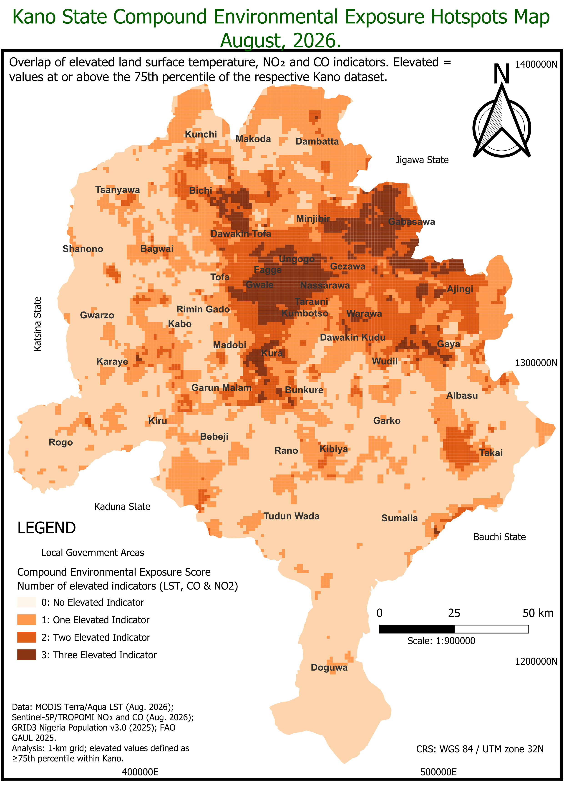
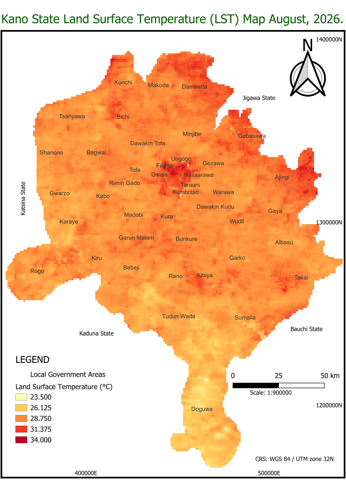
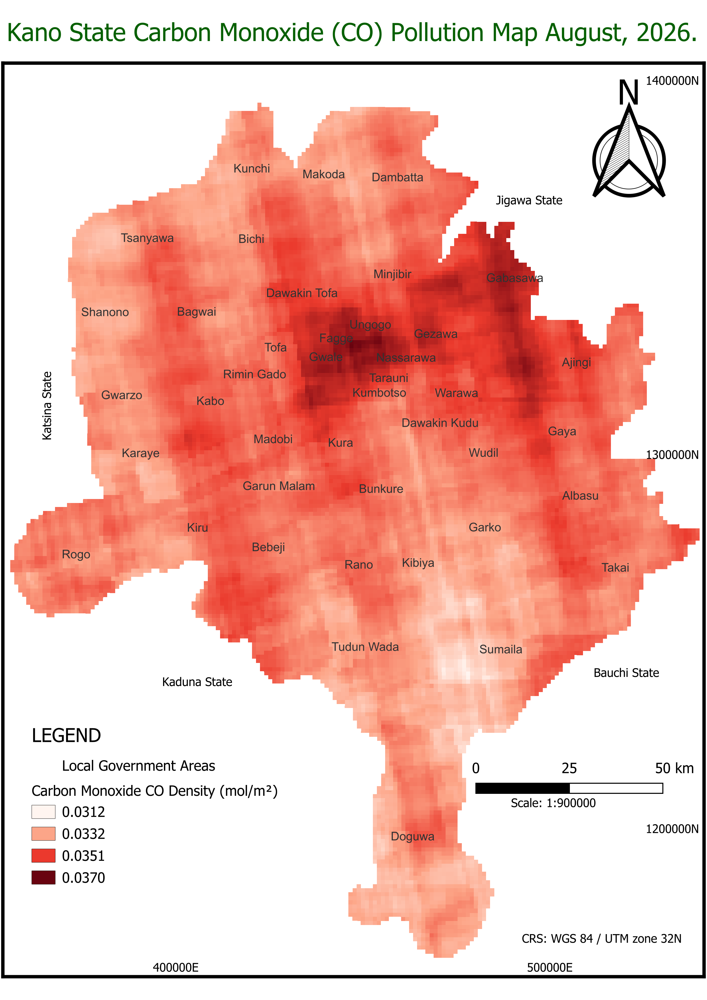
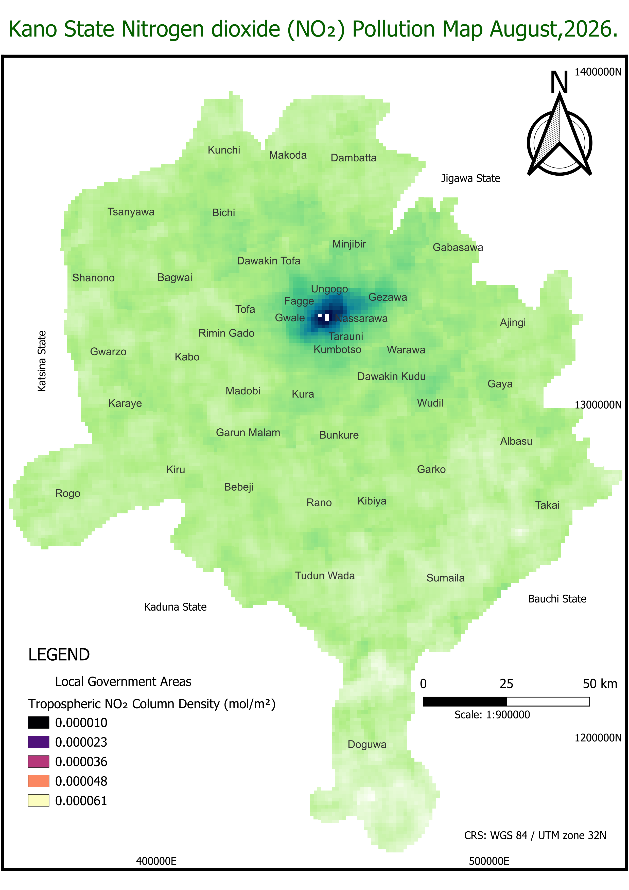

# 🌍 Mapping Environmental Exposure Pathways in Kano State
### DSN AI Bootcamp 2026 — Geospatial Track Portfolio Project

[](https://earthengine.google.com/)
[](https://qgis.org/)
[]()

---

## 📌 Project Overview
Urban centers and regional zones often experience compounding environmental stresses that affect human wellbeing. This project maps and analyzes the spatial distribution of **Land Surface Temperature (LST)**, **Carbon Monoxide (CO)**, and **Nitrogen Dioxide ($\text{NO}_2$)** across **Kano State, Nigeria** for August 2026. 

By combining satellite observations with high-resolution population data on a standardized 1-km grid, the project identifies localized hotspots where multiple environmental exposure indicators overlap.

* **Participant Name:** Abdulbasit Sulayman
* **Community ID:** `DSN/AIPlus/2025/45616`
* **Email:** abdulbasitolokuta@gmail.com
* **Track:** Geospatial Track

---

## 🎯 Problem Statement & Objective
* **Problem Statement:** Kano State experiences environmental conditions that can impact human wellbeing, including elevated land surface temperatures and exposure to atmospheric pollutants ($\text{CO}$ and $\text{NO}_2$). These stressors are unevenly distributed, requiring spatial analysis to uncover areas of compounding exposure.
* **Objective:** Map individual environmental indicators, determine their spatial overlap using a compound score, and provide data-driven insights to guide targeted environmental and health assessments.

---

## 🛠️ Methodology & Technical Workflow
The analytical pipeline was built using cloud-based geospatial computing and desktop GIS:

1. **Study Area Definition:** Utilized administrative boundaries for Kano State.
2. **Data Acquisition:** Pulled satellite imagery via Google Earth Engine (GEE) for August 2026:
   * *MODIS Terra & Aqua* (Daily Land Surface Temperature)
   * *Sentinel-5P / TROPOMI* ($\text{NO}_2$ and $\text{CO}$ tropospheric column density)
3. **Preprocessing (GEE):** Combined and averaged daily LST imagery, converted units, and generated spatial mean column density rasters.
4. **Grid & Percentile Analysis:** Exported rasters to **QGIS** onto a common 1-km grid analysis framework. Values at or above the 75th percentile of the Kano dataset were classified as binary elevated indicators.
5. **Compound Index:** Combined the binary layers to produce a Compound Environmental Exposure Score representing the number of elevated indicators per cell, overlaid with population data for contextual depth.

---

## 📊 Key Maps & Visualizations

### 1. Compound Environmental Exposure Hotspots
A composite multi-hazard index showing the spatial intersection of elevated LST, CO, and $\text{NO}_2$ across Kano State:


### 2. Population & Community Exposure Overlay
Cross-referencing the 1-km compound exposure grid with high-resolution GRID3 population distribution to highlight vulnerable residential corridors:


### 3. Individual Atmospheric & Thermal Indicators
<details>
<summary><b>Click to expand individual indicator maps (LST, CO, NO₂)</b></summary>

#### Land Surface Temperature (LST) - MODIS Terra & Aqua


#### Carbon Monoxide (CO) Tropospheric Column - Sentinel-5P TROPOMI


#### Nitrogen Dioxide (NO₂) Tropospheric Column - Sentinel-5P TROPOMI


</details>


---

## 💡 Strategic Insights & Limitations
* **Key Finding:** Environmental stressors do not occur in isolation; urban and industrial corridors frequently display high compound scores where high LST overlaps with elevated trace gases.
* **Methodological Rigor & Technical Disclaimer:** 
  > *“These areas warrant attention for further environmental and health assessment because multiple environmental exposure indicators are elevated.”* 
  
  *Note:* This map highlights **environmental exposure pathways** based on satellite indices rather than direct medical risk or clinical health outcome data, which requires ground-level validation.

---

## 📂 Repository Structure
```text
├── data/               # Documentation of external data sources
├── maps/               # Exported map images (LST, CO, NO2, Compound Score, Population Overlay)
├── scripts/            # Google Earth Engine and QGIS processing workflows
├── presentation/       # Final DSN submission slide deck (.pptx / .pdf)
└── README.md           # Project documentation